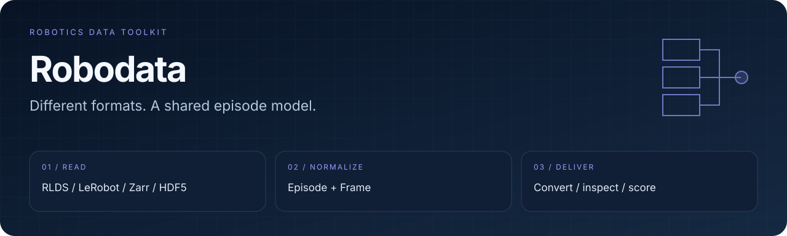
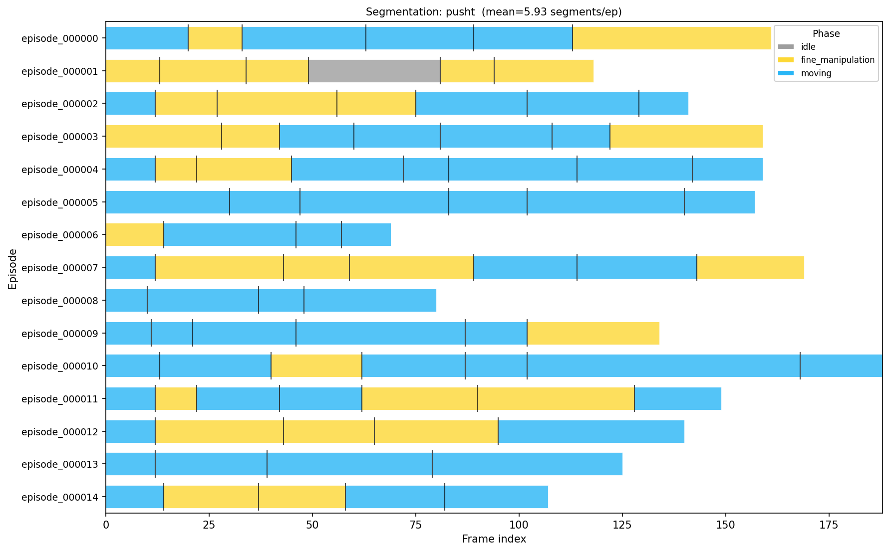

<div align="center">
  
  <h1>Robodata</h1>
  <p><strong>Read, convert and understand robot demonstrations.</strong></p>
  <p>
  
  </p>
  <p>
    <a href="#overview">Overview</a> ·
    <a href="#quick-start">Quick start</a> ·
    <a href="#workflow">Workflow</a> ·
    <a href="#validation">Validation</a> ·
    <a href="#documentation">Documentation</a>
  </p>
  <p><a href="README.md">English</a> · <a href="README.zh-CN.md">简体中文</a></p>
</div>

---

<a id="overview"></a>
## A common language for robot data

**Robodata** brings dataset inspection, format conversion, quality scoring and episode segmentation into one Python toolkit. Readers and writers meet at a shared `Episode` / `Frame` representation, so a new adapter can reuse the rest of the pipeline.

| Move between formats | Understand demonstrations | Find useful data |
| :--- | :--- | :--- |
| RLDS, LeRobot, Zarr, HDF5, Rosbag and RoboDM adapters | Inspect schemas, score quality and identify temporal phases | Browse a dataset registry, filter episodes and inspect outputs |

### Episode segmentation at a glance



*Existing repository example. Segmentation detects changes in proprioceptive signals; phase labels are not a guarantee of semantic task understanding.*

<a id="quick-start"></a>
## Quick start

> [!WARNING]
> **Known startup blocker:** the current [validation module](robodata/validation/engine.py) shadows `dataclasses.field` with a class attribute. A CLI smoke check fails during import with `TypeError: 'NoneType' object is not callable`. The commands below document the intended interface; resolve this code issue before expecting them to run. This documentation update does not change the implementation.

Requires **Python 3.10+**. Install the core first; format adapters have separate optional dependencies.

```bash
git clone https://github.com/eust-w/robodata.git
cd robodata
python3 -m venv .venv
source .venv/bin/activate
python -m pip install -e .

robodata --help
robodata registry list
```

For LeRobot / HDF5 workflows and local visualization:

```bash
python -m pip install -e '.[lerobot,hdf5,video,visualize]'
robodata inspect /path/to/dataset
robodata convert /path/to/hdf5_dataset ./converted --format lerobot-v3
```

Replace the paths with an actual supported dataset. For Hub sources, additionally install `.[hub]`; remote datasets may require their own authentication, downloads and terms of access.

<a id="workflow"></a>
## One intermediate representation

```text
RLDS · LeRobot · Zarr · HDF5 · Rosbag · RoboDM
                         │
                       Reader
                         ▼
                   Episode / Frame
                         │
            inspect · quality · filter · segment
                         │
                       Writer
                         ▼
                 converted dataset
```

### Format adapters

| Format | Read | Write | Dependency group / note |
| :--- | :---: | :---: | :--- |
| RLDS | ✓ | ✓ | `rlds` — TensorFlow / TFDS |
| LeRobot v2 / v3 | ✓ | ✓ | `lerobot`, plus video dependencies as needed |
| GR00T | ✓ | — | LeRobot-style inputs with embodiment metadata |
| Zarr | ✓ | — | `zarr` |
| HDF5 | ✓ | — | `hdf5` |
| ROS bags | ✓ | — | `rosbag` |
| RoboDM | ✓ | ✓ | `robodm`; see the upstream installation note below |

See [format details](docs/format_reference.md) and [model-to-format mapping](docs/model_formats.md) before choosing a conversion target.

<details>
<summary><strong>Optional RoboDM installation</strong></summary>

The existing integration notes recommend installing RoboDM from source when the PyPI codec path is unsuitable:

```bash
git clone https://github.com/BerkeleyAutomation/robodm.git
python -m pip install -e ./robodm
```

RoboDM is an external dependency; its code and datasets retain their upstream terms.

</details>

### Inspect → score → filter → segment

```bash
robodata inspect /path/to/dataset
robodata quality /path/to/dataset --export quality.json
robodata filter /path/to/dataset --min-quality 6.0
robodata filter /path/to/dataset ./filtered --min-quality 6.0

python -m pip install -e '.[segment,visualize]'
robodata segment /path/to/dataset --export segments.json --plot timeline.png
```

The filter command without an output directory previews the selection. Quality scores are diagnostics based on motion signals, not task-success labels or proof that a policy will improve.

| Analysis | What it helps inspect |
| :--- | :--- |
| Smoothness and path length | Abrupt motion, wandering and hesitation |
| Dead actions and static periods | Inactive or near-constant segments |
| Gripper chatter and saturation | Rapid switching and time at action limits |
| Timestamp regularity and entropy | Timing quality and action diversity |

### Python API

```python
import robodata

info = robodata.inspect("/path/to/dataset")
print(info.format, info.num_episodes, info.cameras)
robodata.convert("/path/to/source", "./output", target_format="lerobot-v3")
```

<a id="validation"></a>
## Validation and current scope

```bash
python -m pip install -e '.[dev]'
python -m pytest
robodata registry validate
```

Tests requiring a format backend need that backend's extras. This is an **alpha** toolkit: validate camera mappings, timestamps, action/state semantics and a small converted sample before using a full dataset for training.

Planned work includes dataset merging/splitting, broader depth preservation, a GR00T writer and automated source/output equivalence checks. These are not implied by the current format table.

<a id="documentation"></a>
## Documentation map

| Guide | Focus |
| :--- | :--- |
| [CLI reference](docs/cli.md) · [Configuration](docs/configuration.md) | Commands and conversion settings |
| [Architecture](docs/architecture.md) | Shared data model and adapter design |
| [Quality metrics](robodata/quality/README.md) | Metric definitions and references |
| [Filtering](robodata/filter/README.md) · [Segmentation](robodata/segment/README.md) | Episode selection and temporal analysis |
| [Registry contributions](robodata/registry/CONTRIBUTING.md) | Add or update dataset entries |

## License status

The earlier README described the project as MIT, but this checkout does not contain a root `LICENSE` file. A complete license text still needs to be added by the maintainer. Dataset and dependency licenses remain separate.
